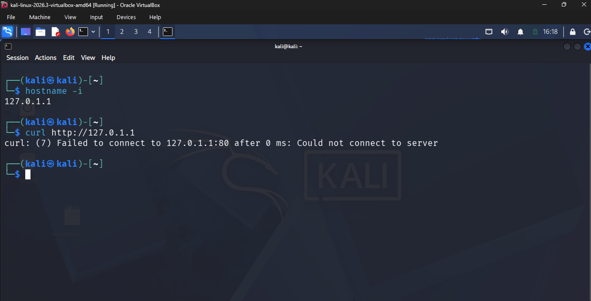
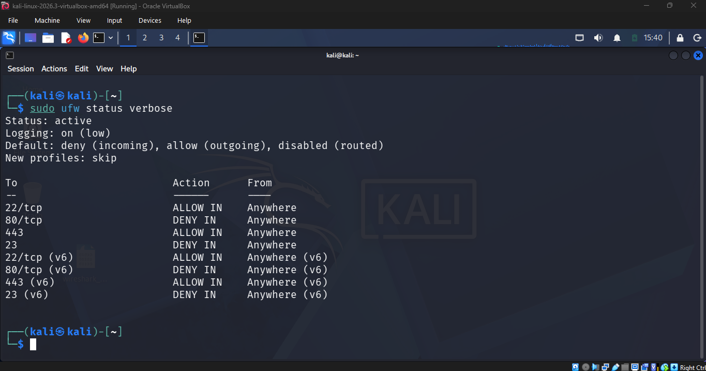

# Task 2: Basic Firewall Configuration with UFW

## Objective
To set up and configure a basic firewall on a Linux system using UFW (Uncomplicated Firewall), applying rules to allow and deny specific types of traffic.

## Environment
- Kali Linux running in a VirtualBox virtual machine
- Tool: UFW (Uncomplicated Firewall)

## What is a Firewall?
A firewall refers to software or a device that filters network traffic based on a set of rules.

## Steps Performed

1. I started by installing UFW:
   ```
   sudo apt install ufw -y
   ```
2. I checked to confirm it was installed:
   ```
   sudo ufw version
   ```
3. I enabled UFW:
   ```
   sudo ufw enable
   ```
4. I updated the rules to allow SSH:
   ```
   sudo ufw allow ssh
   ```
5. I updated the rules to deny HTTP (port 80):
   ```
   sudo ufw deny http
   ```
6. I added two further rules: allowing HTTPS, and denying port 23 (Telnet):
   ```
   sudo ufw allow https
   sudo ufw deny 23
   ```
7. I verified the active rules:
   ```
   sudo ufw status verbose
   ```
8. I tested the updated rules using `curl http://127.0.1.1`, and the connection failed, confirming the HTTP rule was blocking the traffic.

## What Each Rule Achieved

| Rule | What it achieves |
|---|---|
| `allow ssh` | Allows incoming SSH connections (port 22), so the machine can still be accessed remotely for administration |
| `enable` | Turns the firewall on and sets it to start automatically on boot |
| `deny http` | Blocks port 80, because HTTP accepts unencrypted web traffic |
| `allow https` | Allows port 443, the encrypted version of web traffic |
| `deny 23` | Blocks Telnet, an old remote-login protocol that sends data, including passwords, unencrypted |

## Why These Rules Were Chosen
I allowed SSH first, before enabling the firewall, so I would not lock myself out of remote access once the firewall's default deny policy took effect. I denied HTTP because it accepts unencrypted web traffic, and paired it with allowing HTTPS, so that web traffic is still possible, but only in its encrypted form. I denied Telnet for the same reason I denied HTTP, it sends data including passwords with no encryption at all, so there is no good reason to leave it open.

## Testing That Denied Traffic Is Blocked
I tested the deny rule using:
```
curl http://127.0.1.1
```
The connection failed, confirming that UFW was blocking the traffic rather than Apache simply not responding.



## Verifying Active Rules
```
sudo ufw status verbose
```



## Screenshots


## Conclusion
This task showed how a small set of firewall rules can control exactly what traffic reaches a machine. Allowing SSH and HTTPS while denying HTTP and Telnet reflects a simple principle: allow only what is necessary and secure, and block what is unnecessary or insecure.

## References
- UFW documentation: https://help.ubuntu.com/community/UFW
