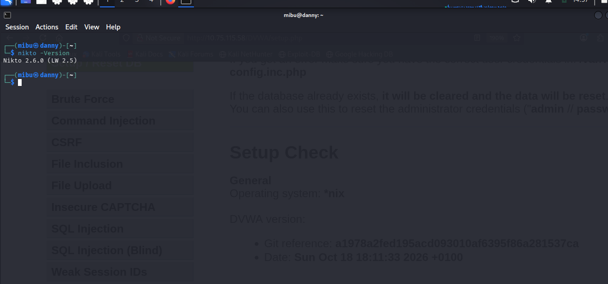
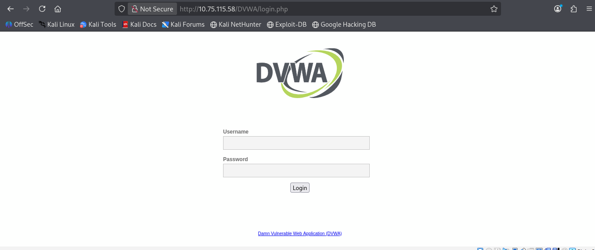
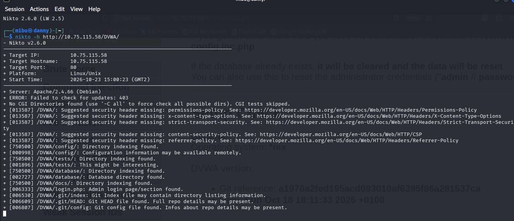
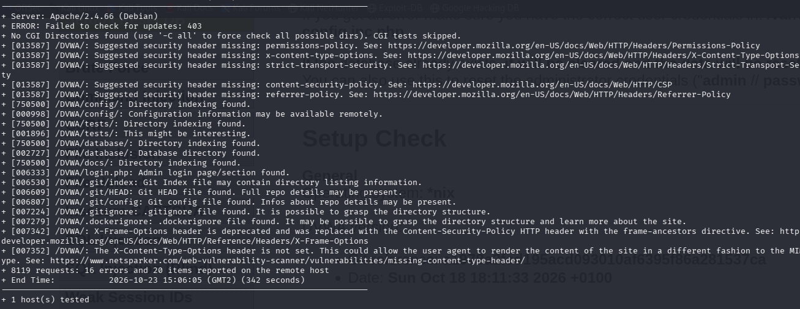
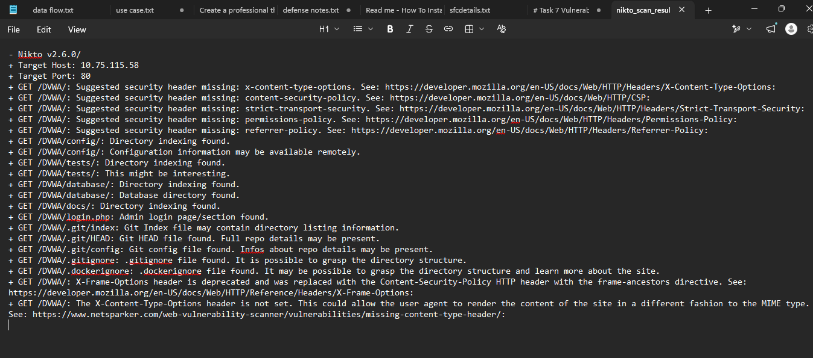
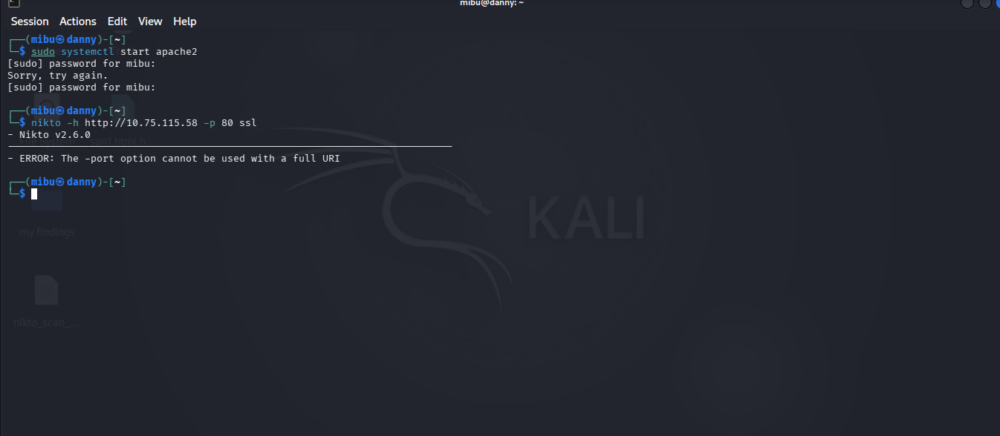

# Task 7: Vulnerability Web Scanning with Nikto

## Objective

Use Nikto to scan an intentionally vulnerable web application (DVWA), identify the issues it reports, explain the risk of each, and rate the severity of each finding.

## Summary of Findings

Nikto completed **8119 requests in 342 seconds** and reported **20 items**. These were grouped into 9 findings. Findings are mapped to the [OWASP Top 10](https://owasp.org/Top10/). The 2021 category is the primary reference, and the 2025 number is given in brackets because the numbering changed between editions.

| # | Finding | Severity | OWASP Top 10 |
|---|---------|----------|--------------|
| 1 | Exposed `/DVWA/config/` directory | High | A05:2021 Security Misconfiguration (2025: A02) |
| 2 | Exposed Git repository (`/DVWA/.git/`) | High | A05:2021 Security Misconfiguration (2025: A02) |
| 3 | Exposed `/DVWA/database/` directory | Medium | A05:2021 Security Misconfiguration (2025: A02) |
| 4 | Exposed `/DVWA/tests/` and `/DVWA/docs/` directories | Medium | A05:2021 Security Misconfiguration (2025: A02) |
| 5 | Exposed `.gitignore` and `.dockerignore` files | Low | A05:2021 Security Misconfiguration (2025: A02) |
| 6 | Missing HTTP security headers | Low | A05:2021 Security Misconfiguration (2025: A02) |
| 7 | Clickjacking protection flagged as outdated | Low | A05:2021 Security Misconfiguration (2025: A02) |
| 8 | Login page discovered at `/DVWA/login.php` | Informational | A07:2021 Identification and Authentication Failures (2025: A07) |
| 9 | Apache version disclosure | Informational | A05:2021 Security Misconfiguration (2025: A02) |

## Authorization

I scanned only my own DVWA instance, running in my own virtual machine. No third party was involved.

## Environment

- **Host:** VMware virtual machine running Kali Linux
- **Network:** NAT, so DVWA was isolated from the external network
- **Target:** DVWA (Damn Vulnerable Web Application) at `http://10.75.115.58/DVWA/`
- **Stack:** Apache 2.4.66, PHP 8.4, MariaDB
- **Tool:** Nikto v2.6.0

## About Nikto

Nikto is an open-source web server scanner. It sends thousands of requests to a web server and compares the responses against a database of known issues. It looks for dangerous or default files, exposed directories, outdated server software and missing security headers.

## Detailed Findings

### 1. Exposed /DVWA/config/ directory: High severity

**OWASP Top 10 (2021): A05:2021 Security Misconfiguration (2025: A02).**

Nikto reported directory indexing for `/DVWA/config/` and possible exposure of configuration information. If sensitive files are accessible, database credentials or other application settings could be disclosed.

**Remediation:** Disable directory indexing with the Apache directive `Options -Indexes` and restrict direct web access to configuration files.

### 2. Exposed Git repository: High severity

**OWASP Top 10 (2021): A05:2021 Security Misconfiguration (2025: A02).**

Files within `/DVWA/.git/`, including `HEAD`, `config`, and `index`, were reported as publicly accessible. This may allow retrieval of source code, commit history, and accidentally committed secrets.

**Remediation:** Remove the `.git` directory from the web root and deny web access to repository metadata and hidden files.

### 3. Exposed /DVWA/database/ directory: Medium severity

**OWASP Top 10 (2021): A05:2021 Security Misconfiguration (2025: A02).**

Nikto identified a browsable database directory. Database scripts and related files may disclose schema details, queries, or implementation information.

**Remediation:** Restrict direct web access to this directory and disable directory indexing.

### 4. Exposed /DVWA/tests/ and /DVWA/docs/ directories: Medium severity

**OWASP Top 10 (2021): A05:2021 Security Misconfiguration (2025: A02).**

These directories were reported as browsable. They may reveal application structure, test cases, or implementation details.

**Remediation:** Disable directory indexing and remove unnecessary test and documentation files from production deployments.

### 5. Exposed .gitignore and .dockerignore files: Low severity

**OWASP Top 10 (2021): A05:2021 Security Misconfiguration (2025: A02).**

These project files were reported as accessible through the web server. Although they do not necessarily contain secrets, they can disclose directory layouts and development or deployment details.

**Remediation:** Block public access to hidden files and exclude unnecessary development artifacts from web deployments.

### 6. Missing HTTP security headers: Low severity

**OWASP Top 10 (2021): A05:2021 Security Misconfiguration (2025: A02).**

The scan reported missing headers including `Content-Security-Policy`, `X-Content-Type-Options`, `Referrer-Policy`, `Permissions-Policy`, and `Strict-Transport-Security`. Their absence can reduce browser-side protections depending on the application.

**Remediation:** Configure appropriate headers in Apache, and enable `Strict-Transport-Security` only after HTTPS is correctly configured.

### 7. Clickjacking protection flagged as outdated: Low severity

**OWASP Top 10 (2021): A05:2021 Security Misconfiguration (2025: A02).**

Nikto flagged the status of `X-Frame-Options` as outdated. The important issue is whether effective framing restrictions are configured.

**Remediation:** Set a suitable `Content-Security-Policy` `frame-ancestors` directive and retain `X-Frame-Options` where useful for compatibility.

### 8. Login page discovered at /DVWA/login.php: Informational

**OWASP Top 10 (2021): A07:2021 Identification and Authentication Failures (2025: A07).**

The application's login page was identified. Its existence is normally expected and is not, by itself, a vulnerability.

**Remediation:** Protect authentication endpoints with rate limiting, strong passwords, secure session management, and multi-factor authentication where supported.

### 9. Apache version disclosure: Informational

**OWASP Top 10 (2021): A05:2021 Security Misconfiguration (2025: A02).**

The server banner disclosed `Apache/2.4.66 (Debian)`. Version disclosure may help attackers investigate software-specific vulnerabilities, but the banner alone does not prove the server is vulnerable.

**Remediation:** Configure `ServerTokens Prod` and consider `ServerSignature Off`, and keep Apache and its dependencies updated.

### Assessment Note

Severity ratings are preliminary and should be validated against the actual configuration, exploitability, and potential impact. DVWA is intentionally vulnerable software designed for security testing, so findings should be interpreted in the context of the authorized lab environment.

Nikto also printed `Failed to check for updates: 403` (it could not download newer plugin data, so the scan used the installed plugins) and `No CGI Directories found` (CGI tests were skipped).

## Nikto Limitations: Why It Is "Noisy"

- It sends thousands of requests quickly (8119 in this scan) and makes no attempt to hide, so it is easy to spot in server logs and by IDS/WAF tools. It is unsuitable for stealthy testing.
- It produces false positives and low-value informational findings, so every result needs manual verification.
- It tests known issues and misconfigurations. It does not understand application logic and does not test authenticated areas well.
- It does not rate severity, so findings must be assessed by the analyst.

## Comparison Between Nmap and Nikto

Nmap is a network scanning tool, whereas Nikto is a web server vulnerability scanning tool.

| Tool | Focus | Example |
|------|-------|---------|
| **Nmap** | Network discovery: identifies active hosts, open ports, and running services. | Identifies port 80 as open and detects an Apache web server. |
| **Nikto** | Web server weaknesses: exposed directories, outdated software, and missing HTTP security headers. | Identifies an exposed `/config/` directory. |

**Key distinction:** Nmap helps determine which network services are accessible, while Nikto helps identify potential security issues associated with a web server. They complement each other: Nmap finds the web service, then Nikto examines it.

## Steps Performed

### 1. Set up the VMware lab

I prepared a Kali Linux VM in VMware. The network adapter was set to NAT.

### 2. Downloaded DVWA from GitHub

```bash
cd /var/www/html
sudo git -c http.version=HTTP/1.1 clone --depth 1 https://github.com/digininja/DVWA.git
```

The first clone failed with `early EOF` because the connection dropped. I retried with HTTP/1.1 and a shallow clone (`--depth 1`), which worked.

I then created DVWA's config file:

```bash
cd /var/www/html/DVWA/config
sudo cp config.inc.php.dist config.inc.php
```

### 3. Started Apache2 and MariaDB

Apache2, PHP, MariaDB and git were already installed. `php-gd` could not be found by apt, so I continued without it. It only affects CAPTCHA images and does not affect the scan.

I created the database and user (using a lab-only password, replaced here with a placeholder):

```bash
sudo mysql -e "CREATE DATABASE dvwa; CREATE USER 'dvwa'@'localhost' IDENTIFIED BY '<your_db_password>'; GRANT ALL ON dvwa.* TO 'dvwa'@'localhost'; FLUSH PRIVILEGES;"
```

MariaDB was not running at first (`ERROR 2002`), so I started it:

```bash
sudo systemctl start mariadb
sudo systemctl start apache2
```

I then set the matching database password in `config.inc.php`.

### 4. Loaded DVWA

I opened `http://10.75.115.58/DVWA/setup.php`, clicked **Create / Reset Database**, and logged in to the DVWA dashboard.

### 5. Network isolation

The VM ran on a NAT network, so DVWA was not reachable from outside the host machine.

### 6. Scanned DVWA with Nikto

Check the version:

```bash
nikto -Version
```

Basic scan:

```bash
nikto -h http://10.75.115.58/DVWA/
```

Scan with saved output:

```bash
nikto -h http://10.75.115.58/DVWA/ -o nikto_scan_results.txt -Format txt
```

**Result:** 8119 requests, 20 items reported, 342 seconds.

**Second scan with an SSL flag check:** This scan could not be performed because DVWA does not support HTTPS.

### 7. Uploaded the results to GitHub

I committed `nikto_scan_results.txt` to this folder in the `OIBSIP` repository.

## Screenshots

**Nikto version**



**DVWA dashboard**



**Basic scan start**



**Basic scan end**



**Saved scan results file**



**SSL flag scan attempt (not supported, DVWA runs over HTTP only)**




## References

1. OWASP Foundation. *OWASP Top 10:2021*. https://owasp.org/Top10/
2. OWASP Foundation. *OWASP Top 10:2025*. https://owasp.org/Top10/2025/
3. Nikto web server scanner. https://github.com/sullo/nikto and https://cirt.net/Nikto2
4. DVWA (Damn Vulnerable Web Application). https://github.com/digininja/DVWA
5. Nmap Project. *Nmap: the Network Mapper*. https://nmap.org/
6. Apache HTTP Server documentation. *Core features* (`Options`, `ServerTokens`, `ServerSignature`). https://httpd.apache.org/docs/2.4/mod/core.html
7. MDN Web Docs. *HTTP headers* (`Content-Security-Policy`, `X-Content-Type-Options`, `Referrer-Policy`, `Permissions-Policy`, `Strict-Transport-Security`, `X-Frame-Options`). https://developer.mozilla.org/en-US/docs/Web/HTTP/Headers
8. ByteMonk. *HTTP Secure Headers for Web App Security | CORS, CSP, HSTS and more*. YouTube. https://www.youtube.com/watch?v=4bQeGUzHpOE

## Files in This Folder

- `README.md`: this report
- `nikto_scan_results.txt`: raw Nikto output
- `screenshots/`: evidence screenshots referenced above
